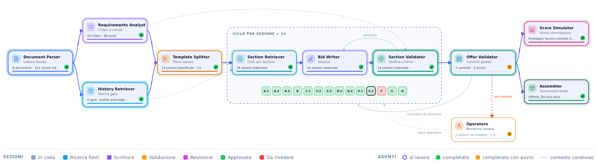

# TenderFlow

Generazione assistita di offerte tecniche per bandi di gara, con una pipeline di agenti Gemini visibile in tempo reale.



| Agente | Cosa fa | LLM |
|---|---|---|
| Document Parser | Estrae testo dai PDF/DOCX del bando e li indicizza | no |
| Requirements Analyst | Ricava dal disciplinare criteri, punti, soglia, vincoli formali | sì (output strutturato) |
| History Retriever | Indicizza le offerte storiche (`docs/Storico/*/Offerta_Tecnica`) e i progetti gold | no (BM25) |
| Template Splitter | Divide il template aziendale per titoli e lo mappa sui criteri del nuovo bando | sì |
| Section Retriever | Per ogni criterio recupera passaggi da template, storico e capitolato | no (BM25) |
| Bid Writer | Scrive la sezione in streaming, adattando lo storico al nuovo committente | sì (streaming) |
| Section Validator | Valuta la bozza come un commissario; se ci sono lacune la rimanda al Writer | sì |
| Offer Validator | Limite facciate, copertura criteri, nomi di gare precedenti residui, coerenza | parziale |
| Score Simulator | Stima il punteggio tecnico e lo confronta con la soglia di sbarramento | no |
| Assembler | Genera `Offerta_Tecnica.docx` (Arial 11, interlinea 1,5) | no |

### Correzioni e intervento umano

- **Correzioni dell'Offer Validator**: incoerenze tra sezioni, norme superate e riferimenti a gare precedenti
  tornano al Writer delle sezioni coinvolte (per un'incoerenza, si corregge la sezione con meno punti allineandola
  a quella con più punti), poi l'offerta viene ricontrollata. Giri massimi: `MAX_DOCUMENT_REVISIONS`.
- **Escalation**: ciò che resta irrisolto, le sezioni "Da rivedere" e i punti `[DA CONFERMARE]` passano al nodo
  **Operatore**.
- **Pausa e Stop**: dall'intestazione l'operatore può mettere in pausa l'elaborazione (nessuna nuova
  chiamata a Gemini finché non riprende) o fermarla del tutto; una run fermata va riavviata da capo.
- **Ripresa (HITL)**: a run conclusa, nella sezione l'operatore compila i dati da confermare e/o una nota;
  la catena riparte dal Writer di quella sezione e ripete Section Validator, Offer Validator (con correzioni),
  Score Simulator e Assembler. I dati inseriti restano vincolanti per tutte le riscritture successive.

## Stack

- **Backend**: Python 3.12, FastAPI, `google-genai`, pypdf, python-docx. Eventi verso il frontend via SSE (`text/event-stream`).
- **Frontend**: React 19 + TypeScript strict, Vite, Tailwind CSS 4.

## Avvio

Prerequisiti: Python ≥ 3.12, Node ≥ 20.

```bash
# Backend
cd backend
python3 -m venv .venv
.venv/bin/pip install -r requirements-dev.txt
cp .env.example .env            # inserire GEMINI_API_KEY (mai committarla)
.venv/bin/python -m app.check_llm          # verifica chiave e modello
.venv/bin/python -m app.knowledge_base     # pre-indicizza lo storico (~30 s la prima volta, poi in cache)
.venv/bin/uvicorn app.main:app --host 127.0.0.1 --port 8000

# Frontend (altro terminale)
cd frontend
npm ci
npm run dev                     # http://localhost:5173
```

**WSL con il progetto sotto `/mnt/c`**: il filesystem Windows non supporta rename atomici né inotify, quindi:

```bash
VITE_CACHE_DIR=$HOME/.cache/tenderflow-vite VITE_POLL=1 npm run dev
```

## Uso in demo

1. Trascinare i documenti del bando, oppure premere **Usa bando di esempio** (carica `SAMPLE_TENDER_DIR`).
   In alto a destra si passa tra modalità chiara (default) e scura; la scelta resta salvata nel browser.
2. Il grafo mostra gli agenti attivi; clic su un agente per i dettagli, su una sezione (chip o lista) per fonti, bozza e lacune risolte.
3. A fine run: punteggio stimato per criterio, controlli sull'offerta, download del DOCX.

Tempi indicativi con `gemini-2.5-flash` e `SECTION_CONCURRENCY=3`: 3–6 minuti per un bando da 14 criteri. Se il piano Gemini ha rate-limit bassi, ridurre la concorrenza: le chiamate fanno comunque retry con backoff esponenziale e jitter su 429/5xx.

## Usarlo su altri bandi e altre aziende

Nessuna logica è legata a un bando specifico: criteri, punti, soglia, limite di facciate e allegati vengono
estratti dai documenti caricati a ogni run.

- **Bando**: si caricano tutti i documenti (PDF/DOCX). Il documento con le regole di valutazione viene
  individuato dal contenuto, non dal nome del file (disciplinare, lettera d'invito, bando…).
  Criteri senza codice vengono numerati `C1, C2, …`.
- **Azienda**: `COMPANY_NAME` nel `.env` e una base di conoscenza in `KNOWLEDGE_BASE_DIR` con questa struttura:

  ```
  Storico/<Nome gara>/<cartella con "offerta" nel nome>/*.pdf|*.docx   risposte tecniche passate
  Progetti Gold/*.pdf|*.docx                                           (opzionale) offerte di riferimento
  Template/*.docx                                                      template aziendale
  ```

  Il template viene diviso per stili Titolo di Word; se assenti, per titoli numerati (`1.2`, `A.1 –`);
  altrimenti è trattato come un'unica sezione.
- **Template per singola gara**: nella schermata iniziale si può caricare un template `.docx` diverso da quello
  predefinito; vale solo per quella run (validato come Word leggibile, altrimenti rifiutato prima di partire).
- **Bando di esempio** (pulsante in home): `SAMPLE_TENDER_DIR`, opzionale.

## Costi

Ogni run conta i token Gemini consumati (input, output e thinking, che Gemini fattura come output) e ne stima il
costo con il listino in `GEMINI_PRICE_INPUT_PER_M` / `GEMINI_PRICE_OUTPUT_PER_M`. Il totale compare a fine run
nell'interfaccia e nei log del backend. Va aggiornato il listino se si cambia `GEMINI_MODEL`.

Con il piano gratuito Gemini i contenuti inviati possono essere usati da Google per migliorare i prodotti:
per documenti di clienti reali usare il piano a pagamento.

## API

| Metodo | Path | |
|---|---|---|
| `GET` | `/health`, `/ready` | liveness / readiness |
| `GET` | `/api/v1/knowledge-base` | template, gare storiche, modello |
| `POST` | `/api/v1/runs` | multipart `files` (PDF/DOCX, validati via magic-byte, max 50 MB ciascuno) e `template` .docx opzionale → `{run_id}` |
| `POST` | `/api/v1/runs/sample` | avvia sul bando di esempio; multipart `template` .docx opzionale |
| `GET` | `/api/v1/runs/{id}/events?after=N` | stream SSE degli eventi (supporta `Last-Event-ID`) |
| `POST` | `/api/v1/runs/{id}/sections/{section_id}/resume` | intervento operatore: `{answers: [{placeholder, value}], note}` → riprende la catena |
| `POST` | `/api/v1/runs/{id}/pause` | pausa: le chiamate al modello già partite terminano, le successive attendono |
| `POST` | `/api/v1/runs/{id}/continue` | riprende una run in pausa |
| `POST` | `/api/v1/runs/{id}/stop` | interruzione definitiva (evento `run.stopped`): niente documento, run non riprendibile |
| `GET` | `/api/v1/runs/{id}/document` | DOCX generato |

Il contratto degli eventi è in `backend/app/schemas.py`, rispecchiato in `frontend/src/lib/types.ts`.

## Test

```bash
cd backend && .venv/bin/python -m pytest      # LLM finto deterministico, nessuna chiamata reale
cd frontend && npm run typecheck
```

## Limiti noti (fuori scope per la demo)

- **Nessuna autenticazione**: esporre solo su `127.0.0.1` o dietro un reverse proxy autenticato.
- **Stato delle run in memoria** (`app/runs.py`): un solo worker uvicorn; per più istanze serve un event store condiviso (es. Redis Streams).
- **Pipeline come task asyncio in-process**: in produzione va spostata su una coda (ARQ/Celery) con stato persistente.
- **Nessun controllo di pertinenza sui documenti caricati**: un documento estraneo viene indicizzato e può finire
  tra le fonti; il disciplinare di un'altra gara può mescolare i criteri; se nessun documento contiene criteri
  l'utente vede solo un errore generico. Da fare: classificazione dei documenti (ruolo, stessa gara via CIG/ente)
  con esclusione motivata in UI e messaggio d'errore esplicito.
- **Retrieval lessicale (BM25)**: semplice e senza costi; un retrieval semantico (embedding) migliorerebbe il recall su sinonimi.
